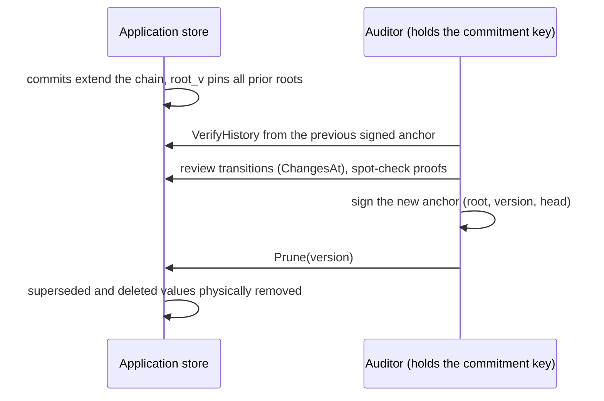

Regulated customers need two properties at once: state they can verify, and data they can genuinely erase. A ledger that must be replayable from genesis can never honour an erasure duty, and a store that simply deletes gives an auditor nothing to check. Immutable Ledger holds both by auditing **state commitments with a committed lineage** rather than a replayable log of operations. History is kept until an audit vouches for it, then pruned.

## The history chain

Enable the chain when the store is created:

```go
store, err := ledger.Create(backend, ck, ledger.WithHistoryChain())
```

The choice is persisted in the authenticated checkpoint and cross-checked against the chain itself at open. It is fixed for the life of the store, because the chain changes which roots a given history produces.

Every effective commit writes one reserved leaf, `ledger.HistoryKey`, holding the chain head:

```
head_v = SHA-256("immutable-ledger:history:v1"
                 ‖ head_{v-1}          32 bytes
                 ‖ root_{v-1}          32 bytes
                 ‖ v                   u64 big-endian)
head_0 = 32 zero bytes
```

Because the head is an ordinary leaf, `root_v` commits to `head_v`, which commits to every earlier root. **The live root pins the entire root lineage.** Rewriting or forking history while staying consistent with the live root would take a preimage attack. The head is provable like any other key: `Prove(HistoryKey)` binds it to an anchored root.

The reserved namespace is not writable by application batches in any mode.

## Audit, sign, prune

Audits are run by the data owner or a delegated auditor, since verifying content needs the commitment key `ck`. Starting from the previous audit's signed anchor `(version_A, root_A, head_A)`, or from the empty state for the first audit:

```go
// 1. Lineage: the recorded roots from the anchor are the unique
//    sequence ending at the live, root-bound head.
err := store.VerifyHistory(versionA, headA)

// 2. Content, as deeply as the engagement requires.
changes, err := store.ChangesAt(v)     // what version v changed
value, ok, err := store.GetAt(v, key)  // verified historical reads
proof, err := store.Prove(key)         // per-key proofs

// 3. Sign the new anchor.
head, version, err := store.HistoryHead()
root, _ := store.Root()
// sign (version, root, head) with the audit key and keep the record

// 4. Prune everything the signature now vouches for.
stats, err := store.Prune(version)
```



After the prune, every superseded and deleted value in the audited range, including the pruned chain segment, is physically gone. The signed anchor stands in for that history from then on, the way a signed audit report stands in for the working papers behind it. The next audit verifies forward from the new anchor.

## What goes into a data-protection policy

- **Erasure latency equals the audit cadence.** Data deleted just after an audit persists, as prunable history, until the next audit's prune. A quarterly audit means deleted data is gone within a quarter.
- **Storage carries the inter-audit history.** Between audits the store keeps every version, so capacity planning follows the audit interval.
- **Verification cost sits with the auditor.** `VerifyHistory` walks stored roots and is fast. Reviewing content with `ChangesAt` costs work proportional to what changed.

## Transitions

`ChangesAt(version)` extracts what a version changed as a structural diff against the version before it: identical subtrees are skipped by hash, so the cost follows the size of the change. Each entry is a tree position and either the new plaintext value or a deletion marker. Tree positions are keyed hashes of the logical keys, which is why content review needs `ck`. `ChangesAt` works on any store; the chain adds the guarantee that the sequence of versions is the real one.

## Who can verify what

| Party | Holds | Can verify |
|---|---|---|
| Data owner or delegated auditor | `ck` | Root lineage, transitions, contents and proofs |
| Third party | Signed anchors and roots | Root lineage and evidence of forks, without seeing contents |

## Interactions

- **SQL transactions and forks** are one commit each, so each adds exactly one link, and a sealed fork's `(root_before, write_set, root_after)` is independently verifiable.
- **Snapshot transfer** carries the head. A restored replica stamped with the source version continues the chain, and `VerifyHistory` works from the transferred anchor.
- **No-op batches** commit nothing and add no link.
- **Roots differ from a store without the chain** over the same data, because the head is part of the state. Replicas must agree on the mode.

## Threat model

- The chain narrows the restart-replay residual described in the [freshness model](/solutions/immutable-ledger/authenticated-store#freshness-model): replaying an old checkpoint with a matching old store now also discards a chain suffix, which the first comparison with any newer anchored head exposes.
- A stripped or replayed checkpoint cannot silently disable the chain, because the mode is cross-checked at open against the head leaf, which the anchored root authenticates.
- History before the earliest retained anchor is vouched for by the audit signature. That is the point of the model: once signed and pruned, the detail is gone by design.
