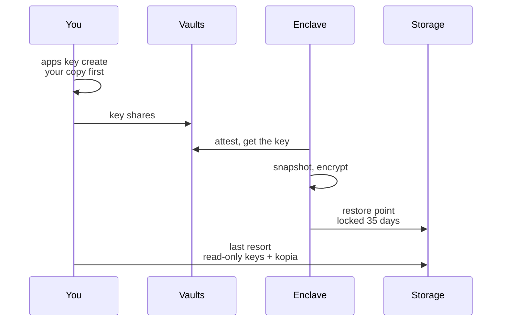

An app with encrypted storage keeps its data on a volume that only its approved code can open. Backups add restore points for that volume, so the data survives a mistake in your app, a lost host or a deleted volume. They are built so that **nobody but you can read them, nobody can tamper with them, and you can recover them without us**.

- **Encrypted under a key you hold.** Backups exist only for apps created with their own key. The enclave running your app takes the backup and encrypts it under that key before anything leaves the confidential hardware.
- **Immutable.** Every object is written to OVHcloud object storage with S3 Object Lock in compliance mode, locked for 35 days. Not even our own credentials can delete or shorten a lock.
- **Recoverable without Privasys.** You can create read-only keys for your app's backups and restore them with [kopia](https://kopia.io), an open-source backup tool, and the key file you hold.

<Callout type="info">
Backups need an app created with `--key-provider byok`. Apps whose storage key the platform generates have no backups: holding the means to read your backups would make us a party to your data.
</Callout>

## How it works



1. **You create the app key.** The CLI generates 32 random bytes on your machine, writes your copy to a file, then splits the key across the [Enclave Vaults](/solutions/enclave-vaults/overview). The vaults release it only to the measurements you approved. You can also bring your own 32 bytes, from an HSM for example.
2. **The enclave backs up.** On your schedule, or when you ask, the enclave snapshots the volume, opens the snapshot read-only and runs kopia to the bucket under a folder for your app. The repository password is derived from the app key, so only the key opens it.
3. **The platform keeps a catalogue.** After each job the enclave reports the restore points and the stored size, so you can list them even while the app is stopped. The bucket stays the source of truth.

The repository password is `hex(HKDF-SHA256(app key, no salt, info "privasys/backup-repository/v1", 32 bytes))`. This is part of the recovery contract and will not change: you can compute it yourself, or let `privasys apps key backup-password` do it.

## Set up backups

### Step 1: Create the app with its own key

```bash
privasys apps create --name my-app --source package --type container \
  --image registry.example.com/my-app@sha256:<digest> --storage --key-provider byok

privasys apps key create my-app --version <version-id> --enclave <enclave-id> --out my-app.key
privasys apps deploy my-app --version <version-id> --enclave <enclave-id>
```

`apps key create` writes `my-app.key` (readable only by you) **before** anything is sent. Keep it safe and offline: it is the only way to recover the app's data and backups if the vaults were ever lost. The platform never sees the key itself, only the vault shares.

### Step 2: Choose a schedule

In the portal, open the app and its **Backups** tab, then **Schedule…**. Or with the CLI:

```bash
privasys apps backup policy my-app --interval hourly --retention standard --redundancy region
```

Each flag changes only its own setting, so `privasys apps backup policy my-app --redundancy zones` moves the backups and keeps the schedule.

| Setting | Options |
|---|---|
| **Interval** (`--interval`) | Every hour, every 6 hours, every day, or off. |
| **Retention** (`--retention`) | **Standard**: hourly for 48 hours, daily for 35 days, weekly for 13 weeks and monthly for 13 months, plus the latest 3. Nothing older than 13 months is kept. **Minimal**: the latest 3 and 7 daily. |
| **Location** (`--redundancy`) | **1 region** (`region`: Gravelines, France) or **3 zones** (`zones`: Paris, France, three availability zones, which survives the loss of a data centre). |

Changing the location of an app that already has backups moves its restore points: the enclave copies them to the new location and switches only once the copy has fully succeeded. The move needs the app running. Backups pause during the move, which takes seconds for small apps and a few minutes per GB.

### Step 3: Back up now, list, check

```bash
privasys apps backup run my-app
privasys apps backup status my-app
privasys apps backup list my-app
```

The portal shows the same: the restore points, the latest job and its result, the stored size and what it costs per month.

## Restore

A restore never overwrites data. In the portal, pick a restore point and **Restore…**: after you confirm by typing the app name, the platform stops the app, deletes its current volume and redeploys onto the restore point. If the current data matters, take a backup first: the dialog offers it.

With the CLI, the same steps are explicit:

```bash
privasys apps stop my-app <deployment-id>
privasys volumes delete <volume-id> --yes
privasys apps deploy my-app --version <version-id> --enclave <enclave-id> --restore <snapshot-id|latest>
```

Restoring onto another enclave works the same way: the app's volume is absent there, so it is created on your key and filled from the backup. That is also how you recover from losing a host.

## Last-resort access: restore without Privasys

From the **Last-resort access** section of the Backups tab, create read-only keys for your app's backups. They can list and read your app's restore points and nothing else: they cannot write or delete, and they cannot see other apps. The secret is shown once; you can replace or revoke the keys at any time.

With the CLI, `create` writes the keys to a file that only you can read and prints the kopia commands below with your bucket, endpoint, region and prefix filled in. The secret never appears on screen:

```bash
privasys apps backup access create my-app --out my-app-backup.env
privasys apps backup access show my-app      # whether keys exist, and where the backups are
privasys apps backup access revoke my-app
```

For a deleted app's kept backups, use `privasys backups access create <app-id> --out <file>` (and `show`, `revoke`) with the app's id.

With those keys and your key file, any Linux or macOS machine restores your data with stock kopia:

```bash
export KOPIA_PASSWORD=$(privasys apps key backup-password --from-file my-app.key)
. my-app-backup.env   # or: export AWS_ACCESS_KEY_ID=<access key id> AWS_SECRET_ACCESS_KEY=<secret>
kopia repository connect s3 --bucket=<bucket> --endpoint=<endpoint> --region=<region> \
  --prefix=apps/<app-id>/ --readonly --no-persist-credentials
kopia snapshot list --all
kopia snapshot restore <snapshot-id> ./restored
```

The keys alone are useless without the app key, and the app key alone needs storage access: keep them apart. If you rotate the app key (`privasys apps key rotate`), the repository opens with the new key; a point-in-time view from before the rotation needs the old one.

## Pricing

Backups are billed per GB **stored**, per hour, rounded up to whole GB. Stored size is after deduplication and compression, so it is usually well below the size of the app's data.

| Location | Price |
|---|---|
| 1 region | 28 credits per GB-hour (about £0.02 per GB-month) |
| 3 zones | 60 credits per GB-hour (about £0.043 per GB-month) |

## Deleting an app

When you delete an app you choose whether its backups go with it. Kept backups stay listed on the **Backups** page of the portal, still billed, and can be opened with last-resort access or deleted there later. Deleting backups stops their billing at once; the storage provider erases the remaining encrypted copies within 35 days, when their lock ends, and they cannot be read without your app key.

## Limits

- Backups cover container apps with encrypted storage and their own key. WASM apps and platform-keyed apps have none.
- A backup copies the volume, not memory: an app that keeps state only in memory should write it to `/data`.
- Each location is one provider region. Replication to a second region is not offered yet.
- The portal never creates, displays or rotates the app key. That stays in the CLI, on your machine.
