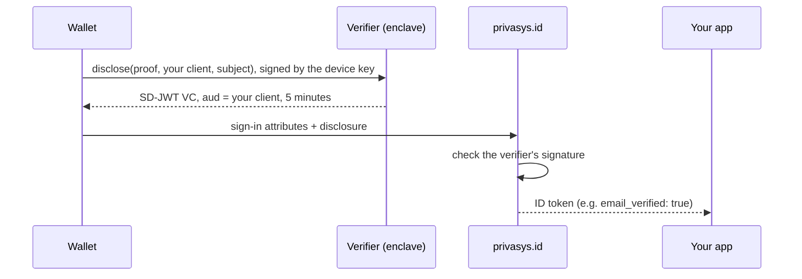

A wallet attribute is only as trustworthy as its evidence. Anyone can type an email address or a date of birth; a relying party that needs to rely on one needs to know it was checked, by whom, and how. Privasys ID answers this with two **verifiers**: confidential apps that check the raw evidence against trust anchors they hold and sign a proof the wallet keeps.

| | Privasys Identity Verifier | Privasys Attribute Verifier |
| --- | --- | --- |
| Checks | the chip of a passport or national ID card, and a live face | a provider's signed ID token, an email code, a card check of a billing address |
| Against | the issuing country's certificates (ICAO master list) | each provider's published signing keys, archived over time; its own mail codes; the Privasys back office |
| Proves | name, date of birth, nationality, document validity, holder presence, and derivations such as `age_over_18` | email, name and profile values, billing address, billing country |
| Source | [container-app-identity-verifier](https://github.com/Privasys/container-app-identity-verifier) | [container-app-attribute-verifier](https://github.com/Privasys/container-app-attribute-verifier) |

Both run inside attested enclaves on the Privasys platform, are AGPL-3.0, and are stateless about people: the wallet holds the evidence and the proofs. privasys.id does not re-validate anything; it checks a verifier's signature, as a relying party can.

## What a proof says

Every Attribute Verifier proof is one signed statement per attribute:

| Field | Meaning |
| --- | --- |
| `attr`, `value` | the canonical attribute and its value |
| `method` | `proven`: the verifier checked cryptographic or back-office evidence. `observed`: the verifier read it itself, over TLS, from inside the enclave (GitHub, which issues no signed token) |
| `source` | who vouches: `google`, `microsoft`, `linkedin`, `oidc:<issuer>`, `github`, `privasys_mail`, `card_bank` |
| `material_at` | when the source asserted the value, never the time of a later re-check |
| `evidence` | what lets anyone check the proof later, such as the digest of the provider's token and the provider's key as the verifier recorded it |
| `measurement` | the image digest of the verifier build that signed it |

Only what passed is signed. An email a provider has not verified is left out, and so is a Microsoft address without `xms_edov`. A billing address is signed only when the card's bank confirmed both the street line and the postcode, and the proof records it as a billing address (`evidence.scope: billing_address`): what the bank holds, not necessarily where the person lives. The billing country is a proof of its own (ISO 3166-1 alpha-2), issued only when the card's issuing country is the country of that address.

## How a proof reaches your app

Apps never receive a stored proof. At sign-in the wallet asks the verifier for a **disclosure**: a short-lived SD-JWT VC of one value, addressed to your client (`aud`), carrying the subject you know the person by and bound to the wallet's hardware key (`cnf.jwk`).

For an email, privasys.id turns a valid disclosure into `email_verified: true` in the tokens it issues to you. Identity Verifier disclosures (`dc+sd-jwt`, `vct` `https://privasys.org/vct/identity-disclosure`) reach your app as the attribute values themselves, so you can keep them as receipts and check them independently.

## Checking a proof yourself

A disclosure is an ES256 JWS followed by `~`. To check one:

1. Resolve the issuer's keys at `https://<iss>/.well-known/jwt-vc-issuer` (or `/.well-known/jwks.json`) and verify the signature.
2. Check `aud` is your client, `exp` is in the future, and `vct` is the type you expect (`https://privasys.org/vct/attribute-disclosure` for the Attribute Verifier).
3. Optionally, attest the verifier: its RA-TLS certificate carries the image digest (OID `1.3.6.1.4.1.65230.3.2`), which must match `evidence.measurement` and a published release.

The Attribute Verifier also attests what it trusts: SHA-256 of its configuration (wallet-provider keys, OIDC providers, back office; secrets excluded) at OID `1.3.6.1.4.1.65230.5.4.1`, and the root of its provider-key ledger at `1.3.6.1.4.1.65230.5.4.2`.

## Provider keys over time

Identity providers publish their signing keys as plain JSON over HTTPS and retire them within weeks, so years later nothing they publish shows a key was ever theirs. The Attribute Verifier fetches every key set hourly and records each key, with when it was first and last seen, in an [immutable ledger](/solutions/immutable-ledger/overview) on its sealed volume. Each proof carries the key record signed by the verifier, so it stays checkable for the whole retention period without contacting the verifier. Each build that opens the ledger records itself and the state it found, so the chain stays continuous across upgrades. `GET /evidence/keys/{source}/{kid}` and `GET /ledger/root` serve the records and the signed root.

## One holder, several devices

Each proof is bound twice: to a key the wallet derives from its seed for that verifier only (the same on all the person's devices), and to one device's hardware key. Third parties never see the holder key, only a salted commitment to it, fresh each time:

- it is the OIDC `nonce` when the wallet imports from a provider, so a token obtained by one wallet cannot be imported by another, even by privasys.id;
- it is stored with a card check, so a check started by one person cannot be claimed by another.

When a proof or an Identity Verifier record reaches another of the person's devices, that device asks the verifier to rebind it to its own hardware key, signed by the holder key. A device removed from the account keeps what it already had but can no longer sign in, so nothing it holds reaches an app again.

## Wallet-only, and free

The verifiers answer the holder's wallet only: every call carries a Wallet Instance Attestation, issued by privasys.id after checking the phone's own attestation (App Attest, Android key attestation), and bound to the key that signs the call. Attribute Verifier proofs and disclosures are free. Identity Verifier disclosures to a relying party are priced through the [attribute marketplace](/solutions/privasys-id/attribute-marketplace).
