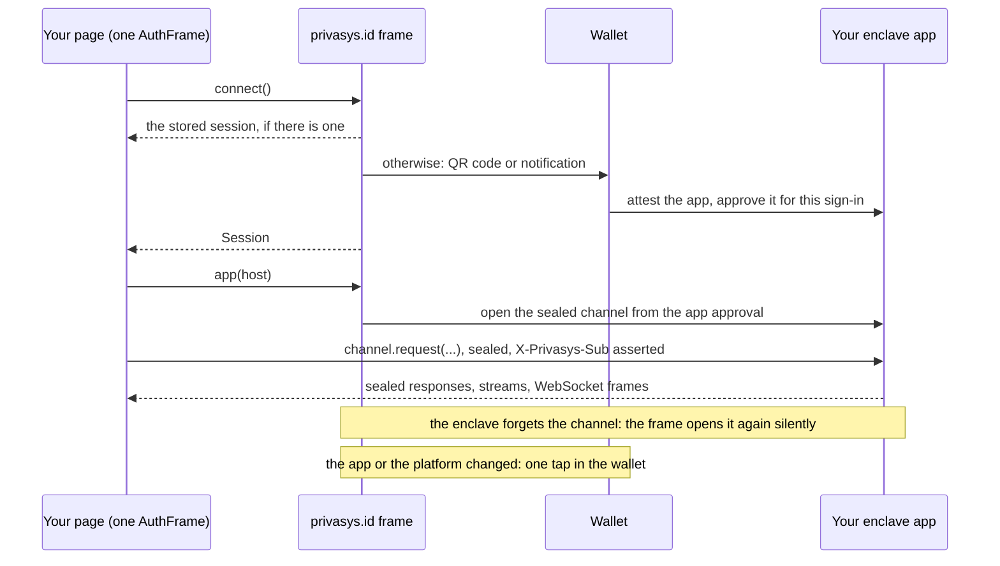

import { Cards, Card } from 'fumadocs-ui/components/card';

This tutorial takes a web front end for an app running on Privasys from nothing to a signed-in person talking to the enclave over a sealed channel. It uses a React provider as the worked example, because that is where most integrations go wrong: not in the first call, but in what the page does when something changes underneath it. By the end you will have a page that signs in, calls the enclave, receives live updates, stays in step with the site's other tabs, and recovers from an idle timeout, an app upgrade or a platform upgrade with at most one tap.

<Callout type="info">
The ideas behind the code are on [Sign-in concepts](/solutions/privasys-id/sign-in-concepts) and the full API on the [Auth SDK page](/solutions/privasys-id/auth-sdk). A page that talks to more than one app continues with [Talk to several enclaves](/tutorials/several-enclaves).
</Callout>

## What you are building



Three things to hold on to:

- **The page never holds a secret.** The sign-in, the tokens and the sealed channel's key all live in a frame on `privasys.id`. Your code gets a channel that seals on its behalf.
- **The channel carries the person's identity.** Inside the enclave the runtime asserts it to your app as the `X-Privasys-Sub` header, so your app authenticates a sealed request by reading one header.
- **The SDK keeps the session and the channel alive.** Your page follows their state; it does not manage them.

## Step 1: Register your website as a client

Registration is operator-assisted today: [contact us](mailto:contact@privasys.org) and we register the client during onboarding. You get a `client_id`, one for your website, and the list of attributes your client may ever ask for is fixed on the client record. Register every origin your pages are served from, a custom domain included.

Your enclave app also serves the page itself in the clear. The enclave serves unsealed responses only for the route prefixes you declare on the app (the root document and its assets); every other route is reached through the sealed channel. Keep the page on hash routing or declare each page route. [Serve a web app from an enclave](/tutorials/web-app-surfaces) shows the declaration.

## Step 2: Load the SDK

Load the hosted client bundle or install the package. The bundle is the usual choice for an app shipped as an image: one reviewed file, no package dependency, and no keys in it.

```html
<script src="https://privasys.id/auth/privasys-auth-client.iife.js"></script>
```

```ts
const { AuthFrame } = window.Privasys;   // or: import { AuthFrame } from '@privasys/auth'
```

## Step 3: One frame for the page

Create a single `AuthFrame` for the life of the page, on first use, and keep it. Everything below runs on that one frame.

```ts
const APP_HOST = window.APP_CONFIG.platformHost;   // 'my-app.apps.privasys.org', served by your app

let auth: AuthFrame | null = null;

export function siteAuth(): AuthFrame {
  auth ??= new AuthFrame({
    clientId: 'my-app',
    appName: 'My App',
    apps: [APP_HOST],                // the sign-in also approves the app: one tap for both
    presentation: 'page',
    methods: ['wallet'],
    pitch: {
      title: 'Your data, sealed.',
      bullets: ['Requests are sealed end to end to the attested enclave.'],
    },
    app: { displayName: 'My App', logoUrl: `${location.origin}/logo.svg` },
  });
  return auth;
}
```

<Callout type="warn">
The host is the app's **platform** hostname, the one the wallet attests. If your page is served from a custom domain, do not derive the host from `location`; have the app serve its platform hostname to the page (a small config script works well).
</Callout>

Three settings deserve a thought:

- **`apps`** lists the app so the sign-in approves it in the same tap. Without it, the first `app(host)` asks the wallet for one more tap.
- **Ask for the minimum.** The default scope, `['openid', 'offline_access']`, signs the person in with nothing else. Adding `profile` asks for a name, and a first-time user who has not added one to their wallet is walked through adding it before the sign-in completes. Ask for an attribute only where you use it.
- **`methods: ['wallet']`** because a sealed channel needs the wallet. To serve people who sign in with a passkey or an external identity provider as well, follow [Passkeys and external identity providers](/tutorials/passkeys-and-external-providers).

There is no rpId and no platform to configure: the rpId is always `privasys.id` and the platform comes from the page's address. See [Sign-in concepts](/solutions/privasys-id/sign-in-concepts).

## Step 4: Connect

```ts
const session = await siteAuth().connect({ container: gateElement });
```

That one call is the whole sign-in surface. On a return visit it resolves silently. Otherwise it renders the gate in your container: a QR code, or a notification to a phone this browser knows, and on a phone a button that opens the wallet.

It rejects with a `ConnectError`: `cancelled` when the person closed the gate, `timeout` when the sign-in was not completed in time, `failed` otherwise. The response to all three is the same: offer a retry that calls `connect()` again on the same frame.

The `session` holds the person's access token (`session.token`), how they signed in (`session.method`) and when the token expires. A sealed app rarely needs the token, because identity reaches the enclave through the channel itself.

## Step 5: Talk to your app

```ts
const api = await siteAuth().app(APP_HOST);

const res = await api.request('GET', '/api/v1/me');
if (res.status === 200) {
  const me = JSON.parse(new TextDecoder().decode(res.body));
}
```

`app()` opens the sealed channel from the approval the sign-in gave. `request()` seals the body and unseals the response. `res.status` is **your app's** status, carried inside the sealed envelope: a 401 or 403 here is your app's decision. The same host always gives the same channel, so calling `app(APP_HOST)` before each request is cheap and safe.

On the server, inside the enclave, authentication is one header:

```go
sub := r.Header.Get("X-Privasys-Sub")   // asserted by the runtime, stripped from anything inbound; your client's own subject for this person
if sub == "" { writeError(w, 401, "sign in required"); return }
```

The runtime strips that header from every inbound request before asserting it, so nothing outside the enclave can set it.

Streams work the same way through `api.stream(...)`, which yields decrypted plaintext bytes (for server-sent events, parse them yourself).

## Step 6: Live updates over a sealed WebSocket

```ts
const ws = await api.openWebSocket('/api/v1/events');
ws.onMessage((bytes) => handle(JSON.parse(new TextDecoder().decode(bytes))));
ws.onClose(() => scheduleReconnect());
await ws.ready;
```

Every frame in both directions is sealed; your app serves a plain WebSocket on the same path, with the same `X-Privasys-Sub` header on the upgrade. Treat the socket as a notice channel and open a new one with backoff when it closes.

## Step 7: Follow the session and the channel

This is the step that makes an integration feel seamless or painful.

**The session.** `onSessionChange` tells the page of every sign-in, renewal, sign-out and expiry, from any tab of the site. Render from it, rather than from what `connect()` returned once:

```ts
siteAuth().onSessionChange((s) => {
  if (s) showApp(s);
  else showSignIn();          // signed out here or in another tab, or expired
});
```

**The channel.** The enclave forgets an idle sealed session after fifteen minutes, and on a restart. The frame opens it again silently from the app approval; the channel's state is `reconnecting` meanwhile. When the approval itself is refused (the app was updated, or the platform under it), or the session ended, the channel moves to `signed-out`. The page then calls `app()` again, which asks the wallet for one tap when needed:

```ts
api.onState(async (state) => {
  if (state !== 'signed-out') return;
  if (!siteAuth().session) return;                 // signed out: onSessionChange shows the gate
  await siteAuth().app(APP_HOST, {
    onApproval: (reason) => showApprovalPrompt(reason),   // null, 'workload-changed', 'enc-changed', 'voucher-expired'
  });
  hideApprovalPrompt();
});
```

`app()` brings back the **same** channel object, working. Your transport, your open views and your in-memory state all survive. What the page must **not** do is react to a failed request by tearing its frame down and starting a new sign-in.

## A complete provider

The pieces above, as a React context. Signed-in views read `useApp()`; the gate shows over them only while the person is needed.

```tsx
const AppContext = createContext<{ api: AppChannel; me: Me } | null>(null);

export function SessionProvider({ children }: { children: ReactNode }) {
  const gateRef = useRef<HTMLDivElement>(null);
  const [session, setSession] = useState<Session | null>(null);
  const [api, setApi] = useState<AppChannel | null>(null);
  const [me, setMe] = useState<Me | null>(null);
  const [approval, setApproval] = useState<string | null | undefined>(undefined);
  const [error, setError] = useState('');

  // The session, from every tab of the site.
  useEffect(() => siteAuth().onSessionChange(setSession), []);

  // Signed in: open the channel. Signed out: show the gate.
  useEffect(() => {
    if (!session) {
      setApi(null);
      siteAuth().connect({ container: gateRef.current! }).catch((e) => setError(e.message));
      return;
    }
    (async () => {
      try {
        const ch = await siteAuth().app(APP_HOST, { onApproval: setApproval });
        setApproval(undefined);
        setApi(ch);
        setMe(await fetchMe(ch));
      } catch (e) {
        setError((e as Error).message);
      }
    })();
  }, [session]);

  // A channel that stopped: the same app() call brings it back.
  useEffect(() => {
    if (!api) return;
    return api.onState((state) => {
      if (state !== 'signed-out' || !siteAuth().session) return;
      siteAuth().app(APP_HOST, { onApproval: setApproval })
        .then(() => setApproval(undefined))
        .catch((e) => setError(e.message));
    });
  }, [api]);

  return (
    <>
      <div ref={gateRef} className={session ? 'hidden' : 'fixed inset-0'} />
      {approval !== undefined && <ApproveInWallet reason={approval} />}
      {error && <Retry message={error} onRetry={() => { setError(''); siteAuth().connect({ container: gateRef.current! }); }} />}
      {api && me && <AppContext.Provider value={{ api, me }}>{children}</AppContext.Provider>}
    </>
  );
}
```

Sign-out is `siteAuth().signOut()`. It ends your client's session on your site, in every tab, and every tab's `onSessionChange` receives `null`. Other sites the person uses are unaffected.

## What happens underneath

- **The app approval.** During the sign-in the wallet attests your enclave, approves it, and uploads a signed approval to the identity provider that binds the enclave's identity key, the app's workload and the person's subject. The frame opens the sealed channel from that approval, which is why the channel carries the identity, and opens it again from the same approval later without the wallet.
- **Idle and restarts.** The enclave keeps a sealed session for fifteen minutes of inactivity. The next request after that is refused; the frame opens the session again from the approval and replays the request. Requests that hit the refusal together share one reopening, because the enclave budgets them.
- **Upgrades.** The approval pins the enclave's measurement. When your app is updated, or the platform under it, the enclave refuses the approval and names the reason; the channel moves to `signed-out`, and `app()` asks the wallet for one approval, which attests the new measurement. Nothing is signed out.
- **Renewal.** The access token is renewed in the background with a refresh token, coordinated across every tab of your site, so each refresh token is spent once. That coordination is one reason for the one-frame rule.

## Mistakes that cost the most

- **Several frames.** Creating an `AuthFrame` per attempt, per component or per app, and destroying them around each other. Keep one per page; the SDK warns when a second is alive for the same client.
- **A sign-in per app.** Reaching a second app by signing in again, or with a second client. Call `app(host)` on the same frame: the session is the same, and the wallet approves the new app with one tap.
- **Rebuilding on a failure.** Treating any failed request as "connection lost" and starting over. A 401 inside the sealed envelope is your app's; a channel that stopped says so with `signed-out`, and `app()` brings it back.
- **Your own retry loops.** Resuming in a loop, or asking the wallet again, when the first call did not return what you expected. The SDK's recovery is budgeted against the enclave's limits; a second loop on top of it is how a sign-in ends in a rate limit.
- **Asking for attributes you do not use.** Every attribute asked for is a consent screen for the person and, for a first-time holder, an onboarding step before your page loads.
- **Deriving the app host from the page's own address.** On a custom domain the sealed channel would be attested against the wrong name.

<Cards>
  <Card title="Talk to several enclaves" href="/tutorials/several-enclaves">
    One frame, one session, a channel per app, and approvals that never interrupt a background task.
  </Card>
  <Card title="Auth SDK reference" href="/solutions/privasys-id/auth-sdk">
    Configuration, methods, sessions, channels, errors and cross-tab behaviour.
  </Card>
  <Card title="Sealed Session" href="/technology/sealed-session">
    The protocol: the binding challenge, what each party sees, silent reopening, and what wakes the person.
  </Card>
</Cards>
