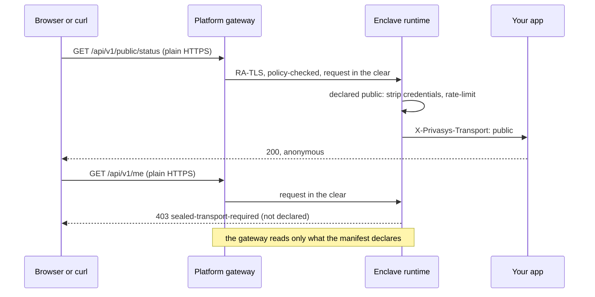

import { Cards, Card } from 'fumadocs-ui/components/card';

A web application on Privasys has a problem a pure API does not. Its page has to load before the user has signed in, a webhook sender has to reach it with ordinary HTTPS, and a plain `curl` should be able to read its public status. None of those callers can verify an RA-TLS certificate or run a sealed session, so those routes are served **in the clear** through the platform gateway, which can read them. Everything else stays private. This tutorial shows how an application declares that split, what the platform enforces around it, and how to check every part of it from outside.

By the end you will have deployed the [`container-app-web`](https://github.com/Privasys/container-app-web) template on the test environment, confirmed its clear routes as the owner, verified each surface with `curl`, delivered a signed webhook, read the declaration on the Attestation tab, and shipped a change to it.

<Callout type="info">
This assumes the [CLI](/solutions/cli) is installed and you are signed in (`privasys auth login`). Every command below targets the test environment with `--test` (see [choosing an environment](/solutions/cli/scripting#choosing-an-environment)); drop the flag to do the same on production. The rules are on the [deploy containers](/solutions/platform/developer-platform/deploy-container#surfaces-private-static-and-public) page and the trust argument on the [gateway](/solutions/platform/gateway) page. This page is the how.
</Callout>

## What you are building

The template is one small service with three surfaces:

| Route | Surface | Who reaches it | What the gateway sees |
| --- | --- | --- | --- |
| `/` and `/assets/` | **static** | any browser, GET and HEAD | the page, in the clear (measured code, no user data) |
| `GET /api/v1/public/status` | **public** | anyone with HTTPS | request and response, in the clear |
| `POST /api/v1/webhooks/demo` | **public**, with the `X-Demo-Signature` header | a webhook sender | request and response, in the clear |
| `GET /api/v1/me` | **private** | a signed-in browser over a sealed session, or an attested client | sealed bodies, or nothing on the RA-TLS leg |
| `GET /api/v1/events` | **private** | a signed-in browser over the sealed WebSocket | sealed frames |



Three things to hold on to:

- **Private is the default.** A route is served in the clear only because the manifest says so, per method and path.
- **The declaration is measured.** It rides the image label the enclave verifies at load, so it is part of the attested digest and visible to anyone who checks.
- **Clear means anonymous.** The runtime strips every credential before your code runs, so a public handler cannot act on an identity even by mistake.

## Step 1: Fork the template

Fork [`Privasys/container-app-web`](https://github.com/Privasys/container-app-web) on GitHub and clone your fork. The repository publishes its image to GitHub Container Registry on every tag, and its README says how to build and push your own. For the first deploy we use the published image as it is, and we come back to your fork in step 8 to change the manifest.

## Step 2: Read the manifest

Open `privasys.json` at the root of the repository. The `surfaces` block is the whole declaration:

```jsonc
{
  "tools": [ /* the API, declared as tools */ ],
  "surfaces": {
    "static": ["/", "/assets/"],
    "public": [
      { "method": "GET",  "path": "/api/v1/public/status" },
      { "method": "POST", "path": "/api/v1/webhooks/demo", "headers": ["X-Demo-Signature"] }
    ],
    "cors": "*"
  }
}
```

Read it against the route table above. `/` is the root document only, and `/assets/` is a prefix, both for GET and HEAD. The two public routes are one method each; nothing implies a `POST` on the status route or a `GET` on the webhook. The webhook declares the one extra header it needs; every other header an anonymous sender adds is dropped before the handler sees the request. `/api/v1/me` and `/api/v1/events` are nowhere in the block, and that absence is what makes them private.

The manifest is carried by the `org.privasys.manifest` label of the image, and the label is inside the digest-pinned image configuration. Edit the block, rebuild, and the image digest changes. We will see that in step 8.

## Step 3: Create the app

Create a package app from the published image, then give it the listing every app needs before its first deploy:

```sh
privasys apps create --name web-surfaces --source package \
  --image ghcr.io/privasys/container-app-web:v0.1.0 --test
privasys apps store-listing web-surfaces \
  --description "Three surfaces: a page, a public API and a webhook" \
  --category "Developer Tools" --test
```

```text
FIELD             VALUE
name              web-surfaces
id                7c1e…
source            package
container_image   ghcr.io/privasys/container-app-web:v0.1.0
status            built
```

The platform reads the manifest label from the image when it records the version, so the surfaces are already known to it before anything runs. Pin the image by digest (`@sha256:…`) for anything beyond a walkthrough; a tag can move, a digest cannot.

## Step 4: Deploy, and confirm the routes in the clear

```sh
privasys apps deploy web-surfaces --watch --test
```

The version serves four routes in the clear and no owner has confirmed them yet, so the platform refuses to ship it until you do. The CLI shows the routes and asks:

```text
This version serves 4 routes in the clear (4 new since the last confirmation).
The platform gateway reads traffic on these routes; the enclave serves them anonymously.
  static /  (new)
  static /assets/  (new)
  GET /api/v1/public/status  (new)
  POST /api/v1/webhooks/demo  (new)
Confirm these routes carry no personal data? [y/N] y
✓ surfaces confirmed
⠹ pulling image → starting container → active
✓ active, routable (6s)
```

Read the list before you answer. What you confirm is recorded with the version, the exact routes, your identity and the time, next to the attestation that records the routes themselves. It is asked once per version, and only when a version puts something in the clear beyond what an owner last confirmed. The next version with the same block ships without a question.

Two ways to do the same thing without the prompt:

```sh
privasys apps deploy web-surfaces --watch --confirm-surfaces --test   # for CI, after you have reviewed the diff
privasys apps versions confirm-surfaces web-surfaces --test           # confirm on its own, deploy later
```

Note the hostname the deploy prints; the rest of the tutorial uses it as `$HOST`.

```sh
HOST=web-surfaces.apps.test.privasys.org
```

## Step 5: Verify the three surfaces with curl

Four requests prove the declaration from outside, with a plain HTTPS client that could not talk to the enclave any other way.

**A public read answers, and says which leg served it.** The `X-Privasys-Transport` header is set by the runtime and never by a client:

```sh
curl -i https://$HOST/api/v1/public/status
```

```text
HTTP/2 200
content-type: application/json
cache-control: public, max-age=10
access-control-allow-origin: *
x-privasys-transport: public

{"status":"ok","version":"v0.1.0"}
```

**A private route refuses a request in the clear.** Nothing in the manifest covers `GET /api/v1/me`, so the runtime answers before your code runs:

```sh
curl -i https://$HOST/api/v1/me
```

```text
HTTP/2 403
content-type: text/plain; charset=utf-8

sealed-transport-required
```

**A burst is bounded.** The runtime keeps a token bucket per client address on the clear leg, with the defaults of 10 requests per second and a burst of 50. Sixty requests in a row spend the bucket:

```sh
for i in $(seq 1 60); do
  curl -s -o /dev/null -w '%{http_code}\n' https://$HOST/api/v1/public/status
done | sort | uniq -c
```

```text
     50 200
     10 429
```

```sh
curl -i https://$HOST/api/v1/public/status
```

```text
HTTP/2 429
content-type: application/json
retry-after: 1

{"error":"too many requests on a public route"}
```

Wait a second and the bucket refills at 10 per second. The limit protects the enclave, which is answering under a trusted certificate to anyone; raise it in `surfaces.limits` when a public feed draws real traffic.

**A preflight is answered by the runtime.** The template sets `"cors": "*"`, so a page on any origin may call the public routes, without credentials, and the runtime answers `OPTIONS` itself with exactly the declared methods and headers:

```sh
curl -i -X OPTIONS https://$HOST/api/v1/webhooks/demo \
  -H 'Origin: https://example.com' \
  -H 'Access-Control-Request-Method: POST'
```

```text
HTTP/2 204
access-control-allow-origin: *
access-control-allow-methods: POST
access-control-allow-headers: Accept, Content-Type, X-Demo-Signature
access-control-max-age: 600
x-privasys-transport: public
```

There is no `Access-Control-Allow-Credentials` and there never will be on a public route: a public response never sets a cookie, so a browser has nothing to send past the gateway.

## Step 6: Deliver a signed webhook

The webhook route is public because its sender cannot run our transport. Its authentication is the signature over the body, which the route declared as `X-Demo-Signature`; the template verifies an HMAC-SHA256 under a shared secret (its README says where the secret is configured). Sign a body with `openssl` and post it:

```sh
SECRET=demo   # the template default; set DEMO_WEBHOOK_SECRET in the deployment to change it
BODY='{"event":"order.paid","id":"ord_42"}'
SIG=$(printf '%s' "$BODY" | openssl dgst -sha256 -hmac "$SECRET" | awk '{print $2}')

curl -i -X POST https://$HOST/api/v1/webhooks/demo \
  -H 'Content-Type: application/json' \
  -H "X-Demo-Signature: $SIG" \
  --data "$BODY"
```

```text
HTTP/2 202
content-type: application/json
x-privasys-transport: public

{"accepted":true,"id":"evt_…"}
```

Change one character of the body and post it again with the same signature: the handler answers `401`. The header reached the handler because the route declared it. A header the route did not declare, such as an `X-Api-Key` the sender invented, is dropped by the runtime before the handler runs, so the handler cannot be written to trust it.

Now attach a credential by mistake, the way a page would if it put a bearer on a public fetch:

```sh
curl -s -o /dev/null -H 'Authorization: Bearer not-a-real-token' https://$HOST/api/v1/public/status
```

The request succeeds, the bearer never reaches the handler, and the runtime counts it. You will see that counter in the next step: the gateway has already read a credential, and the point of the counter is that you find out on the test environment rather than in production.

<Callout type="warn">
Everything on this leg transits the gateway in the clear: the path, the query string, the headers and the body, both directions. Keep webhook payloads minimal and signed, and have your app fetch the details back over a private channel. The gateway logs TLS metadata and route outcomes only, never a header, a query string or a body, and keeps nothing; what you put on a declared surface is still yours to answer for.
</Callout>

## Step 7: Read the declaration on the Attestation tab

Open the app in the [developer platform](/solutions/platform/developer-platform) and go to its **Attestation** tab. Under the measurements there is a section titled **Served in the clear**, listing the same four routes you confirmed in step 4, the identity that confirmed them and when. The same list appears on the app's store listing, so a user choosing the app sees the declaration before trusting it. If the counter from step 6 is non-zero, the tab also shows that credentials reached the gateway on a public route.

The CLI prints the same from the version record:

```sh
privasys apps describe web-surfaces --test
```

```text
FIELD                VALUE
name                 web-surfaces
status               active
hostname             web-surfaces.apps.test.privasys.org
version              v0.1.0
served_in_the_clear  static /, /assets/; GET /api/v1/public/status; POST /api/v1/webhooks/demo
```

The routes are read off the measured image; the confirmation is the platform's record of who vouched for them, kept with each version (`privasys apps versions web-surfaces --test` lists them, with `surfaces_confirmed_by` and `surfaces_confirmed_at`). An attestation check closes the loop between the two:

```sh
privasys attest web-surfaces --test
```

```text
quote type    TDX Quote
challenged    true   nonce 9b2f1e40…
workload      code 3a7c08d1…   image container-app-web:v0.1.0
quote status  OK
✓ VERIFIED    hardware attestation matches the source
```

The `workload code` digest covers the image whose label carries the manifest. Keep it in mind for the last step.

Before that, open `https://$HOST/` in a browser. The page loads in the clear (it is the static shell: measured code, no user data), and its sign-in follows the [auth SDK tutorial](/tutorials/integrate-auth-sdk). Once signed in, the page calls `/api/v1/me` over the sealed session, and the handler sees `X-Privasys-Transport: sealed` with the user's `X-Privasys-Sub` asserted by the runtime. The same URL that answered `403` to `curl` now answers, because the request arrived on the private surface.

## Step 8: Change a surface and ship it

Add a public route in your fork's `privasys.json`, a feed of the webhook events the app accepted:

```jsonc
"public": [
  { "method": "GET",  "path": "/api/v1/public/status" },
  { "method": "GET",  "path": "/api/v1/public/feed" },
  { "method": "POST", "path": "/api/v1/webhooks/demo", "headers": ["X-Demo-Signature"] }
]
```

Build and push the image the way the template's README describes, then record it as a new version of the app, pinned by the digest the push printed:

```sh
privasys apps versions create web-surfaces \
  --image ghcr.io/<you>/container-app-web@sha256:<digest> --test
privasys apps deploy web-surfaces --watch --test
```

Two things happen, in this order. The platform compares the new version's surfaces with the set you confirmed in step 4 and finds one route it has not seen, so it asks again, for this version:

```text
This version serves 5 routes in the clear (1 new since the last confirmation).
The platform gateway reads traffic on these routes; the enclave serves them anonymously.
  GET /api/v1/public/feed  (new)
  GET /api/v1/public/status
  POST /api/v1/webhooks/demo
  static /
  static /assets/
Confirm these routes carry no personal data? [y/N] y
✓ surfaces confirmed
```

Then the deploy proceeds with a new image digest. Run `privasys attest web-surfaces --test` again and the `workload code` line has changed, because the manifest label is inside the measured image configuration. Anyone checking the attestation sees a different digest, and the Attestation tab now lists five routes. If you had created the app with `--storage`, this is also where the [upgrade gate](/tutorials/enclave-upgrade) would ask you to approve the new measurement before the data key unlocks for it; the surfaces confirmation and the measurement approval are two separate records of two separate decisions.

Redeploy the same version later, or ship a further version with the same block, and nothing is asked: the confirmation carries forward until a version adds something new.

## What you learned

- Everything a container serves is private unless its manifest declares a static prefix or a public route, per method and path. An undeclared route on the gateway's terminated leg answers `403 sealed-transport-required`.
- The declaration is measured. It rides the image label the enclave verifies at load, so changing it changes the attested digest, and verifiers read the routes off the image.
- A clear request is anonymous by construction: the runtime keeps an allow-list of headers in both directions, drops and counts any credential, never asserts an identity, rate-limits per client, answers preflights itself, and tells your code which leg it is on with `X-Privasys-Transport`.
- An owner confirms the routes a version puts in the clear, once per version, and the platform records who and when. The Attestation tab and the store listing show the routes to users.
- The gateway reads only what is declared, logs transit metadata only, and keeps nothing.

## Command reference

| Step | Command |
| --- | --- |
| Create from the image | `privasys apps create --name <app> --source package --image <ref> --test` |
| Deploy, confirm when asked | `privasys apps deploy <app> --watch --test` |
| Confirm without a prompt | `privasys apps deploy <app> --confirm-surfaces --test`, or `privasys apps versions confirm-surfaces <app> [version] --test` |
| Read the surfaces | `privasys apps describe <app> --test` |
| Ship a change | `privasys apps versions create <app> --image <ref>@sha256:<digest> --test` |
| Verify the digest | `privasys attest <app> --test` |

<Cards>
  <Card title="Surfaces: private, static and public" href="/solutions/platform/developer-platform/deploy-container#surfaces-private-static-and-public">
    The full declaration, the rules the runtime enforces, and what you must never do on a public route.
  </Card>
  <Card title="Gateway" href="/solutions/platform/gateway">
    The two legs, what the gateway can and cannot read, and what it logs.
  </Card>
  <Card title="Integrating the auth SDK" href="/tutorials/integrate-auth-sdk">
    The private surface from a browser: sign-in, the sealed session and the sealed WebSocket.
  </Card>
  <Card title="container-app-web" href="https://github.com/Privasys/container-app-web">
    The template, with the four curls as its smoke test.
  </Card>
</Cards>
