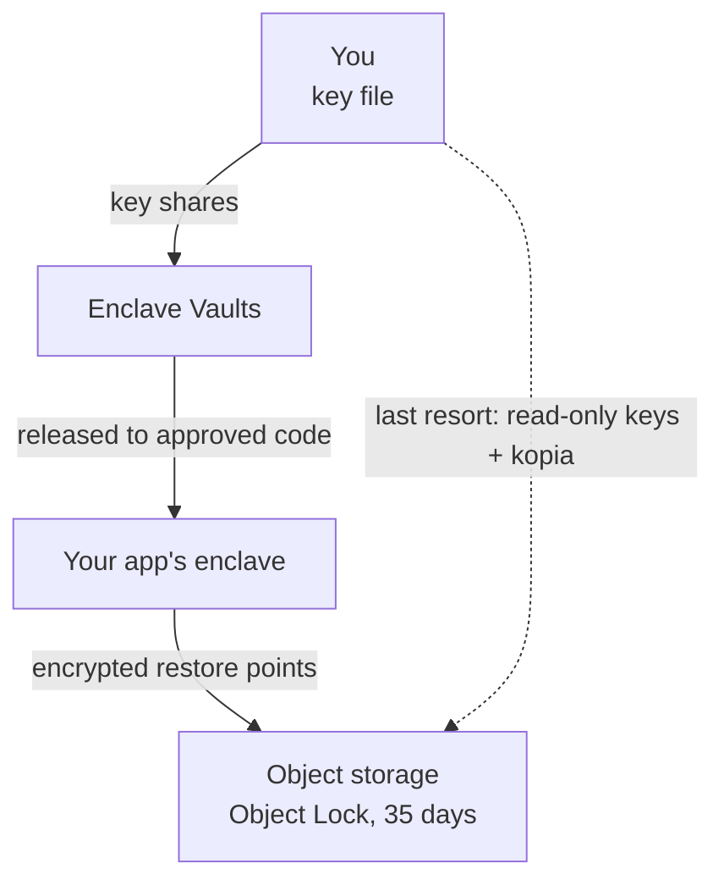

On Privasys, an app's encrypted volume opens only inside attested hardware, with a key that the vaults release to the measurements its owner approved. Until now, that volume had no restore points: a bad release that corrupted a table, a failed host or a deleted volume meant the data was gone. Restore points are copies of the data that live elsewhere and for longer, so they need the same protection as the volume itself.

Today we are releasing backups for apps on the Privasys platform. The restore points are encrypted under a key you hold and written with a 35-day compliance lock, during which no credential, ours included, can delete them. You can recover them with open-source tools and your key file, without any Privasys service.

## Existing approaches

**Provider snapshots** copy the disk on a schedule and restore it in one step. The provider can read what it copies, or holds the key that can, and a confidential app is designed to rule that out.

**Client-side encrypted backup tools** such as restic and kopia encrypt the data before it leaves, under a password only the owner knows. We use kopia. Inside an enclave, two things get in the way: nothing outside the hardware can see the files to back them up, and a password set in the app's configuration is another secret to provision, rotate and keep.

Many confidential deployments therefore run without backups. We built backups that run inside the enclave, use the key the owner already holds, and can be restored without us.

## How backups work

Backups are available for apps created with their own key. When you create such an app, the CLI generates 32 random bytes on your machine, writes your copy to a file first, and only then splits the key across the [Enclave Vaults](/blog/enclave-vaults-rethinking-secrets-management-for-the-age-of-confidential-computing). The vaults release it to your app's enclave only when the enclave proves, by attestation, that it runs code you approved. You can also bring your own key, from an HSM for example.



The enclave running your app takes the backups. On your schedule (every hour, every 6 hours or every day) or on request, it snapshots the volume, opens the snapshot read-only and runs kopia to object storage. The repository password is derived from the app key with HKDF, so the key that opens your volume also opens your backups and there is no separate password. The derivation is published and fixed, so you can compute it yourself.

**Every object the enclave writes is locked for 35 days.** Today the storage is OVHcloud object storage, and the next version will let you choose your own object storage. Each object is written with S3 Object Lock in compliance mode, under which no credential, ours included, can delete an object or shorten its lock. A compromised account or a faulty script can add a delete marker, but the locked versions remain readable until the lock ends.

Restore points are kept in one of two locations: one region in Gravelines, or three availability zones in Paris, which continues to serve if one data centre is lost. If you change the location later, the enclave copies the existing restore points across and switches only after the copy has completed.

## Restoring

On the app's Backups tab in the [developer portal](https://developer.privasys.org), you pick a restore point and confirm by typing the app's name. The platform stops the app, removes the current volume and redeploys onto the restore point. A restore never writes over existing data without that confirmation, and the dialog offers to take a fresh backup first. A restore onto a different host works the same way, which is how an app recovers from losing its machine: the volume is absent there, so it is created under your key and filled from the backup.

We measured the full cycle on our production platform with a small app. A backup took about 15 seconds end to end, with its objects locked for 35 days. Moving its restore points from one region to three zones took 14 seconds, and restoring an earlier point from the Paris copy brought the app back with the earlier data.

## Recovering without Privasys

A backup service usually works only while its operator does. Owners on Privasys can recover their data even if our platform is unavailable.

From the same tab, or with `privasys apps backup access create`, you can create **read-only keys** for your app's backups. They can list and read that app's restore points and nothing else: they cannot write, delete, or see any other app. With those keys and your key file, any Linux or macOS machine restores the data with stock kopia:

```bash
export KOPIA_PASSWORD=$(privasys apps key backup-password --from-file my-app.key)
export AWS_ACCESS_KEY_ID=<access key id> AWS_SECRET_ACCESS_KEY=<secret>
kopia repository connect s3 --bucket=<bucket> --endpoint=<endpoint> --region=<region> \
  --prefix=apps/<app-id>/ --readonly --no-persist-credentials
kopia snapshot restore <snapshot-id> ./restored
```

Recovery needs both the read-only keys and your app key. The storage keys cannot decrypt the repository, and the app key cannot reach the bucket. Creating the keys took 13 seconds on our production platform. The secret is shown once, and you can replace or revoke the keys at any time.

## Pricing and limits

Backups are billed per GB stored, per hour: about £0.02 per GB-month in one region, and about £0.043 per GB-month across three zones. Stored size is measured after deduplication and compression, so it is usually well below the size of the app's data. When you delete an app, you choose whether its backups are deleted with it. Kept backups remain listed and billed, and can still be opened with read-only keys, for example to keep the records of a finished project.

Backups cover container apps with encrypted storage and their own key. Apps whose key the platform generates have no backups, by design: if we held the means to read your backups, we would have access to your data. Each location is a single provider region today, and replication to a second region is planned. The key is created and rotated with the CLI on your machine, and the portal never handles it.

## Summary

Confidential computing ensures that only approved code reads your data. Backups give every copy of that data the same protection, under a key only you hold, and the recovery path uses open-source tools, so it does not depend on Privasys being available.

*Backups are documented at [docs.privasys.org](https://docs.privasys.org/solutions/platform/developer-platform/backups), and you can turn them on from the Backups tab of any app created with its own key in the [developer portal](https://developer.privasys.org).*
