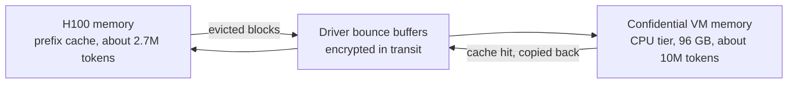

An agent resends its whole conversation on every turn: the system prompt, the tool definitions, every earlier message and every tool result. By the twentieth turn of a coding or research session, that is tens of thousands of tokens, and only the last few hundred are new. A model server avoids reading the same tokens twice with its prefix cache: the attention state computed for a prompt (the KV cache) stays in GPU memory, and the next request that starts with the same tokens reuses it instead of computing it again.

GPU memory is finite, though. When many sessions run at once, the cache evicts the oldest blocks to make room, and the agent whose turn comes next pays for its whole context again. Today our Confidential AI instances gain a second tier for that cache, in the confidential VM's own memory, so an evicted block can be copied back instead of recomputed. This post explains why that needed a change on an H100 in confidential computing mode, what it keeps private, and what it costs.

## Existing approaches

**More GPU memory, or fewer sessions per GPU,** keeps more of the cache resident. It works, at the price of the hardware or of the number of people an instance can serve.

**KV cache offloading to host memory** is the usual answer, and vLLM ships it. Its simple CPU offload connector keeps a pool of KV blocks in host RAM: blocks the GPU evicts are stored there, and a later request that matches them loads them back over PCIe. Projects such as LMCache take the same idea further, to disk and to other machines.

Both assume a GPU that can reach host memory directly. The vLLM connector allocates its pool in ordinary host memory and pins it with `cudaHostRegister`, so the GPU can copy to and from it without the CPU's help. In confidential computing mode the GPU has no direct access to the confidential VM's memory: everything that crosses PCIe goes through bounce buffers that the driver encrypts, and the driver refuses to register private VM memory for direct access. On an H100 in this mode, the engine therefore stops at start-up with `RuntimeError: cudaHostRegister failed`. vLLM's other connector only warns on the same failure, but it keeps its pool in `/dev/shm`, which a container limits to 64 MiB.

## What we changed

The change is small. When vLLM detects NVIDIA confidential computing, the CPU offload connector keeps its pool unpinned, and its copies run from ordinary pageable memory. The driver stages those copies through its encrypted bounce buffers, as it already does for every other transfer in this mode. We have open-sourced it today for anyone running vLLM on confidential GPUs, and proposed it upstream as [vllm-project/vllm#69432](https://github.com/vllm-project/vllm/pull/69432), with a unit test and an end-to-end run on CC hardware; it is waiting for review. Our Confidential AI instances already run it.

**The CPU tier stays in the confidential VM's private memory.** The pool is an anonymous private mapping inside the TDX guest, encrypted by the CPU like the rest of the VM's memory, and the blocks cross PCIe only inside the driver's encrypted transfers. The host sees neither the blocks nor the tokens they were computed from.

Isolation between callers carries over unchanged. Every request on our instances has a cache salt, derived from the verified identity of the caller, and vLLM folds it into the hash of each KV block. A block in the CPU tier keeps that hash, so a caller can only ever hit their own earlier blocks, which also rules out learning someone else's prompt from cache-hit timing. A request sent with `X-Privasys-Reproducibility: strict` gets a single-use salt and never reuses any block, in either tier.

Reproducibility carries over too. With the batch-invariant kernels described in [Same Prompt, Same Answer](/blog/reproducible-inference-and-the-accountability-gap), a seeded request returns byte-identical output whether its prefix was computed fresh, loaded back from the CPU tier or found on the GPU. We check that on every release with the same replay tests that cover the GPU cache.

## What it costs and what it saves

All figures below come from our production hardware: one H100 NVL in confidential computing mode, in an Intel TDX guest, serving Qwen3.6-35B-A3B in FP8 with an FP8 KV cache. Each token of context takes about 9.5 KB of cache, so the GPU holds about 2.7 million tokens and a 96 GB CPU tier about 10 million more.

**Copying back is fast.** We sent a 6,505-token prompt cold, cleared the GPU prefix cache (which leaves the CPU tier in place), and sent it again: vLLM's counters show 6,336 of its tokens loaded from the CPU tier, and the output matched. Time to first token was 0.188 s from the CPU tier against 0.146 s from GPU memory. That 42 ms gap, for about 60 MB of cache, puts the encrypted copy at around 1.4 GB/s, or roughly 150,000 tokens of context per second.

**Recomputing gets expensive as the context grows.** This model computes a short prefix very quickly, because only about 3 billion of its 35 billion parameters are active per token and 30 of its 40 layers use linear attention. Its ten full-attention layers grow with the square of the length, though, and agent sessions are long. We measured the prefill time on the production instance at five lengths, as the difference between a cold request and the same request served from the GPU cache, and set it against the copy time at 150,000 tokens per second:

| Context | Recompute (measured) | Copy back from the CPU tier (at 1.4 GB/s) |
|---|---|---|
| 16,000 tokens | 0.54 s | about 0.11 s |
| 43,000 tokens | 1.41 s | about 0.29 s |
| 85,000 tokens | 3.84 s | about 0.57 s |
| 160,000 tokens | 10.5 s | about 1.1 s |
| 245,000 tokens | 20.8 s | about 1.6 s |

At 85,000 tokens the copy is almost seven times faster than the recompute, and at 245,000 tokens about thirteen times.

**The difference matters most with hundreds of users.** Take 150 agents, each in a session of 85,000 tokens and taking a turn every two minutes, so 75 turns a minute arrive at the instance. GPU memory alone keeps about 32 of those sessions, so four turns in five find their prefix evicted and recompute it: about 59 recomputes a minute at 3.8 s each, or close to four minutes of prefill work for every minute of time. One GPU cannot keep up, so turns queue and the time to first token keeps rising for everyone. With a 96 GB CPU tier, about 118 more sessions of that length stay cached, so all 150 fit. Each turn then copies its prefix back in about 0.6 s and computes only its new tokens, and the copies add up to about 34 seconds a minute on the transfer path, leaving the GPU's compute for the work that is new. That is the difference between an instance that serves 30 long agent sessions well and one that serves 150.

These session figures are a model built from the measurements above, with turns spread evenly over time; real traffic is burstier, and the copy rate comes from one 6,500-token reload. We will publish the hit rates and times to first token we see on agent traffic once we have a few weeks of them.

## Design choices

**We start with the instance's own memory.** This post covers offloading to local RAM inside the confidential VM, which already carries the hardware's protection. The same approach scales to a cache shared across a cluster, so that when an instance goes down, another can take over its sessions straight away with their context already computed. In confidential computing mode that sharing needs the cache to stay protected between attested instances, which takes more work, and we will cover it in a future post.

**We copy through the driver's encrypted bounce buffers.** A GPU outside confidential computing mode would use pinned transfers, which are faster. The encrypted path is what keeps the cache confidential on its way across PCIe, and at around 1.4 GB/s it already brings a long prefix back many times faster than the GPU can recompute it.

Keeping a conversation's state close to the model is what makes long agent sessions affordable. On a confidential instance that state is as sensitive as the prompts it came from, so it stays inside the same boundary, under the same per-caller isolation, whichever tier holds it.

*Confidential AI is open source under the AGPL-3.0 licence: [github.com/Privasys/confidential-ai](https://github.com/Privasys/confidential-ai). Our vLLM changes are in [github.com/Privasys/vllm](https://github.com/Privasys/vllm), and the CPU offload change is proposed upstream as [vllm-project/vllm#69432](https://github.com/vllm-project/vllm/pull/69432).*
